  

  

  
  
  

## 👨‍💻 About Me

  

- 🎓 **Communications & Technology Engineering** student at **Nile Academy for Engineering & Technology** — class of 2029
- 💼 **Arabic Market Operations** at **Siya** (voice social app, MENA) since 2022 — managing 5 partner agencies & 6 supporters, verifying users, and resolving complaints end to end
- 🔐 Studied **Network Security**, **CCNA** and **CCNP**; comfortable on **Linux** and **Windows**
- 🌍 Working day to day with an international management & tech team
- 📫 Reach me at **muhammadaliattai@gmail.com**

<b>🇪🇬 نبذة بالعربي</b>

 

أنا **محمد علي عطية**، طالب هندسة اتصالات وتكنولوجيا في **أكاديمية النيل للهندسة والتكنولوجيا**.
بشتغل في **عمليات السوق العربي** في تطبيق **Siya** للتواصل الصوتي من 2022، ومهتم بـ **أمن الشبكات** (CCNA · CCNP) وبناء تطبيقات مفيدة.
متاح للعمل **عن بُعد**.

## 🛠️ Tech Stack

  

  
  
  
  
  

## 🚀 Featured Projects

  
  
  
  

## 📊 GitHub Stats

  
  

  

  

  

  <picture>
    <source media="(prefers-color-scheme: dark)" srcset="https://raw.githubusercontent.com/muhammadaliattai-source/muhammadaliattai-source/output/github-snake-dark.svg" />
    <source media="(prefers-color-scheme: light)" srcset="https://raw.githubusercontent.com/muhammadaliattai-source/muhammadaliattai-source/output/github-snake.svg" />
    
  </picture>

## 🤝 Let's Connect

  
  
  

  

