

  

  <a href="#about"></a>
  <a href="#journey"></a>
  <a href="#toolkit"></a>
  <a href="#projects"></a>
  <a href="#activity"></a>
  <a href="#contact"></a>

  



<b>نبذة بالعربي</b>

 

أنا **محمد علي عطية**، طالب هندسة اتصالات وتكنولوجيا في **أكاديمية النيل للهندسة والتكنولوجيا** (دفعة 2029).
بشتغل في **عمليات السوق العربي** في تطبيق **Siya** للتواصل الصوتي من 2022: بدير الوكالات الشريكة والداعمين، وبتحقق من المستخدمين، وبتابع الشكاوى لحد ما تتقفل.
مهتم بـ **أمن الشبكات** (CCNA · CCNP) وبعمل مشاريع ويب. متاح للعمل **عن بُعد** وأقدر أبدأ فورًا.






  <a href="https://github.com/muhammadaliattai-source/oscar-app"></a>

  <a href="https://github.com/muhammadaliattai-source/mr-one"></a>
  <a href="https://github.com/muhammadaliattai-source/fatwa"></a>


  


  <a href="mailto:muhammadaliattai@gmail.com"></a>


